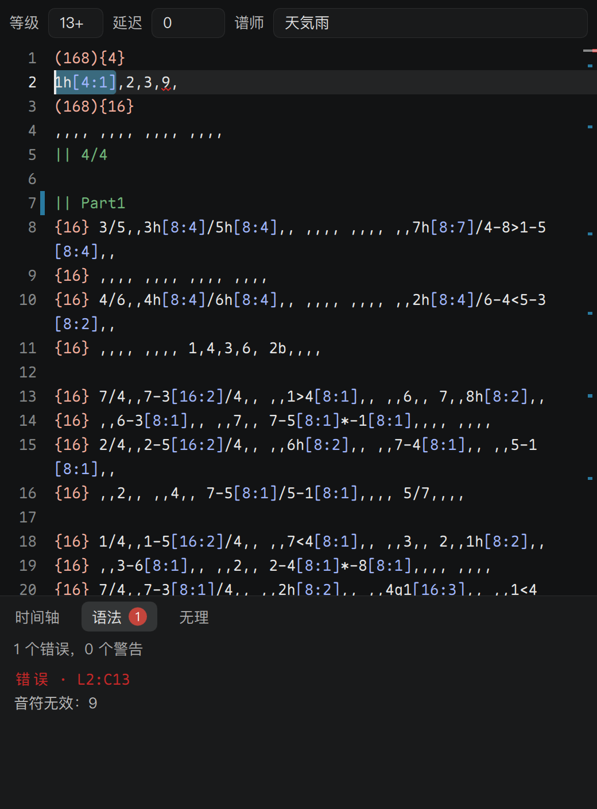
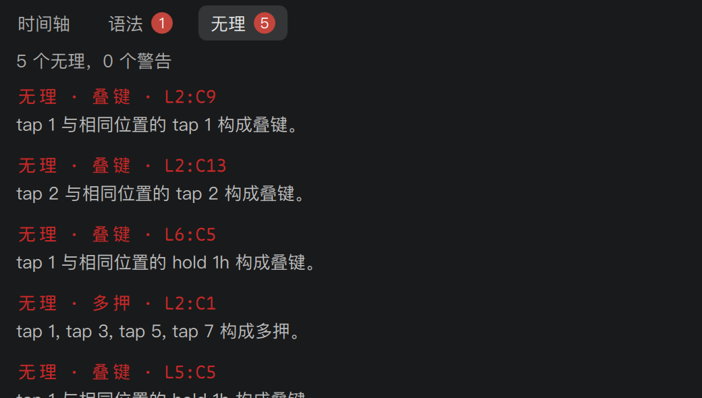
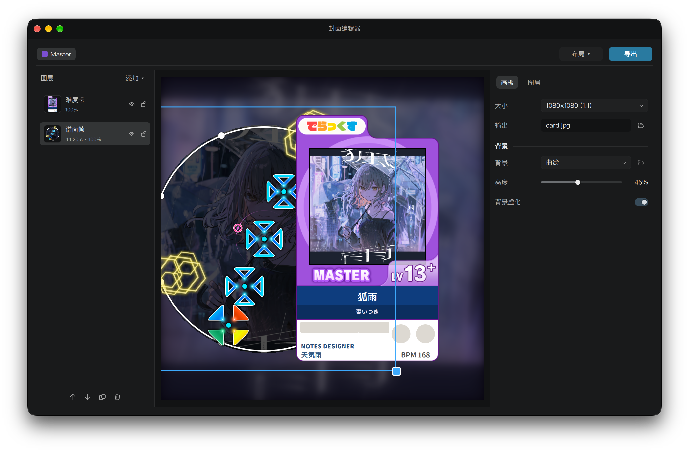
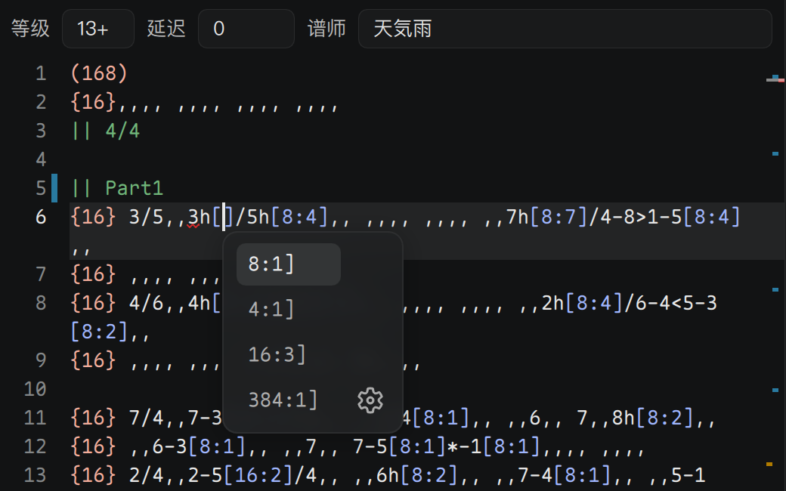
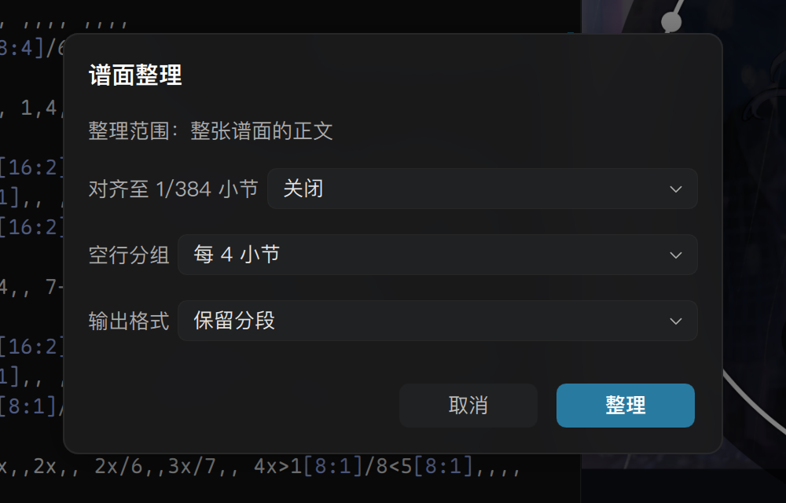
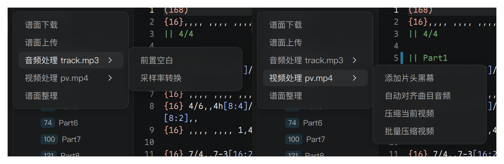
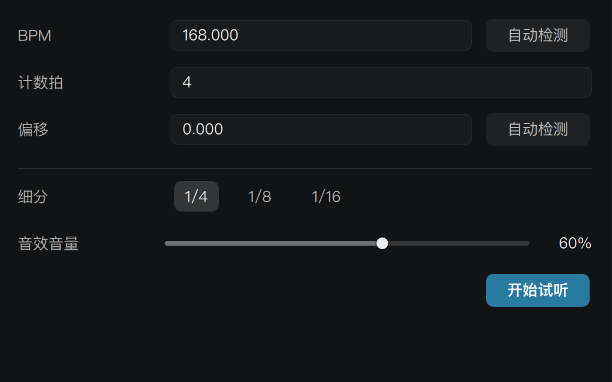

<p align="center">
  
</p>

<h1 align="center">MiaCode</h1>

<p align="center">
  <a href="https://github.com/Team-MiaCode/MiaCode/releases/latest"></a>
  <a href="https://github.com/Team-MiaCode/MiaCode/stargazers"></a>
  <a href="LICENSE"></a>
</p>

<p align="center">
  <a href="README.md">中文</a> | <a href="README_EN.md">English</a>
</p>

MiaCode 是一款基于 Qt 6 / C++ / QML 的 maimai 谱面创作工具，集成编辑、实时预览、语法与无理检测、视频导出和封面创作。

<p align="center">
  
</p>

<details>
  <summary>浅色主题</summary>
  <p align="center">
    
  </p>
</details>

截图展示 macOS 界面，使用《狐雨》（棗いつき）的谱面，谱师为天気雨。

## 快速开始

正式发布包见 [GitHub Releases](https://github.com/Team-MiaCode/MiaCode/releases)。

nightly 构建包见 [GitHub Actions](https://github.com/Team-MiaCode/MiaCode/actions/workflows/package.yml)，选择 `dev` 分支的构建记录。

支持 Windows（x64 / ARM64）与 macOS（Apple 芯片），下载对应系统和架构的压缩包后解压。

- **Windows**：双击解压目录中的 `MiaCode.exe` 启动。
- **macOS**：双击 `MiaCode.app` 启动，也可将其拖入“应用程序”文件夹。若系统显示安全提示，可在解压目录打开终端，执行 `xattr -dr com.apple.quarantine "MiaCode.app"` 后启动。

Linux 用户可按下方步骤从源码构建。

### 打开第一张谱面

1. 打开 simai 格式的 `maidata.txt`，或将音频拖入工作区创建谱面。
2. 在侧栏编辑歌曲信息、选择难度，在编辑器内编写谱面。拖动波形时间轴或预览进度条查看段落配置。
3. 使用“保存”写入当前编辑页，或使用“保存整个文档”写入全部难度与歌曲信息。发布时可从侧栏打开视频导出或封面工具。

## 功能介绍

### 编辑与预览

- 支持 simai 谱面编辑、语法高亮与时值补全，歌曲信息和各个难度通过标签页切换。
- 通过段落书签定位，波形时间轴展示音符位置、长按时值与滑条轨迹。
- 键入修改实时更新预览，暂停时可拖动进度查看配置；支持变速播放与分离预览窗口。
- 面板宽度可调，编辑器与预览区可左右交换；支持深浅主题和中、英、日三种语言，主题与语言可跟随系统。
- 支持自定义皮肤、判定线、预览字体与工作区背景。

### 语法与无理

<table align="center" width="100%">
  <tr>
    <td align="center" width="50%"></td>
    <td align="center" width="50%"></td>
  </tr>
  <tr>
    <td align="center">语法检查</td>
    <td align="center">无理检测</td>
  </tr>
</table>

语法检查按行列出错误与警告，无理检测标记叠键、撞尾等配置。点击检测结果可跳转到对应源码与预览位置。

### 视频与封面

#### 导出

<p align="center">
  
</p>

导出包含片头、背景视频与可选谱面信息、音符统计的预览视频。可在导出工作区设置分辨率、帧率、音频码率与编码器。

支持自定义导出区间、使用播放位置设置起止点，或将编辑器中的谱面选区套用到导出区间；导出前可试听所选区间。

#### 封面

<p align="center">
  
</p>

导出用于发布谱面视频的平台封面。

以图层组合难度卡片、谱面帧、图片与文字，可调整位置、大小、层叠顺序和透明度，设置字体与背景，并将布局保存为预设。

### 更多实用功能

<table align="center" width="100%">
  <tr>
    <td align="center" width="50%"></td>
    <td align="center" width="50%"></td>
  </tr>
  <tr>
    <td align="center">时值自动补全</td>
    <td align="center">谱面整理</td>
  </tr>
  <tr>
    <td align="center"></td>
    <td align="center"></td>
  </tr>
  <tr>
    <td align="center">音视频工具</td>
    <td align="center">BPM 与延迟检测</td>
  </tr>
</table>

- 输入法禁止、全角字符转换与选区拍数显示。
- 通过预览触控板编写 Touch 音符，调整音符位置，整理整张谱面或所选段落。
- 音频转为 44.1 kHz、前置空白、PV 与音频对齐，以及单个或批量视频压缩。
- 检测 BPM 与音频偏移，通过延迟校准页面试听并调整对齐。

## 构建

### 依赖

- CMake 3.21+
- C++20 编译器
- Qt 6.10+，包含 Qt Quick、Quick Controls 2、Quick 3D、Multimedia、Shader Tools、Linguist Tools，以及 Multimedia 私有开发头文件

更详细的打包说明见 [scripts/README.md](scripts/README.md)。

### 获取源码

克隆开发分支并初始化 ScintillaQuick 编辑器子模块：

```bash
git clone --branch dev --recurse-submodules https://github.com/Team-MiaCode/MiaCode.git
cd MiaCode
```

已有仓库在配置前执行 `git submodule update --init --recursive`。

### Windows

手动安装以下构建工具：

- Visual Studio 2022 或 Build Tools 2022，选择“使用 C++ 的桌面开发”
- CMake 3.21+
- Python 3（包含 pip）

使用一键脚本自动安装 Qt、准备依赖、构建并打包：

```powershell
powershell -ExecutionPolicy Bypass -File .\scripts\build\build-win.ps1 -Toolchain msvc -BuildJobs 4
```

ARM64 主机使用 `-Toolchain msvc-arm64`，并选择独立构建目录；参数见 [scripts/README.md](scripts/README.md)。

### macOS

使用 Apple 芯片 Mac，系统版本为 macOS 13 或以上。在终端安装 Xcode Command Line Tools，并通过 [Homebrew](https://brew.sh/) 安装 CMake 和 Python 3：

```bash
xcode-select --install
brew install cmake python
```

安装脚本默认使用的 Qt 6.11.1（包含 Multimedia、Shader Tools 和 Quick 3D），准备预览 SDK 与导出用 FFmpeg，然后构建并打包：

```bash
python3 -m pip install aqtinstall
python3 -m aqt install-qt mac desktop 6.11.1 clang_64 --outputdir .qt \
  --modules qtmultimedia qtshadertools qtquick3d
bash scripts/ffmpeg/ensure-macos-ffmpeg-dev.sh
bash scripts/ffmpeg/ensure-macos-ffmpeg.sh
bash scripts/build/build-macos-local.sh
```

已有 Qt 时可设置 `QT_ROOT`；本地脚本复用依赖，输出位于 `dist/`。

### Linux（适用于高级用户）

Linux 无打包脚本，需要手动安装 CMake 3.21+、C++20 编译器、pkg-config 和 Qt 6.10+（包含 Qt Quick、Quick Controls 2、Quick 3D、Multimedia、Multimedia 的私有开发头文件、Shader Tools 和 Linguist Tools），以及 FFmpeg、VA-API、DRM、OpenGL / EGL 的开发库。FFmpeg 开发库需包含 `libavfilter`、`libavcodec`、`libavformat`、`libavutil`、`libswresample` 和 `libswscale`。

在仓库根目录执行以下命令，将 `[/path/to/Qt/6.x/gcc_64]` 替换为 Qt 安装目录：

```bash
cmake -S . -B build -DCMAKE_BUILD_TYPE=Release \
  -DCMAKE_PREFIX_PATH="[/path/to/Qt/6.x/gcc_64]"
cmake --build build --target MiaCode --parallel 4
./build/bin/MiaCode
```

音视频处理与导出使用独立的 `ffmpeg` 程序，可手动安装支持 H.264 / AAC 编码的 FFmpeg。

## 仓库结构

- [src](src)：应用源码
- [assets](assets)：运行资源、素材与生成数据
- [resources](resources)：Qt 资源、应用图标与界面截图
- [scripts](scripts)：构建与维护脚本
- [third_party](third_party)：第三方依赖
- [docs](docs)：文档
- [samples](samples)：规格测试示例资源

## 许可证

自有代码使用 MIT 协议，随仓库分发的 Release 构建产物为非商业使用，具体边界见 [LICENSE_SCOPE.md](LICENSE_SCOPE.md)。

第三方库、字体、音效、图片、FFmpeg、BASS、Qt 以及参考实现的各自许可证或分发限制参考 [THIRD_PARTY_NOTICES.md](THIRD_PARTY_NOTICES.md)。

## 致谢

感谢 [Minepig/MaiMuriDX](https://github.com/Minepig/MaiMuriDX) 提供的无理检测功能参考。

感谢 [gfdfdxc/maimai-transition](https://github.com/gfdfdxc/maimai-transition) 提供的片头动画参考。

感谢 [Majdata Net](https://majdata.net/) 提供的自制谱面社区。

感谢 [MaiViewer](https://www.maiviewer.net/) 提供官方谱面抄谱下载站。

特别感谢 hitomi 老师无偿提供 MiaCode logo 绘制。

感谢内部测试时期给出建议、复现问题和协助调试的朋友们，名单见 [ACKNOWLEDGEMENTS.md](ACKNOWLEDGEMENTS.md)。

## 社群

欢迎加入 MiaCode 官方 QQ 交流群：1095435375

<p align="center">
  
</p>
